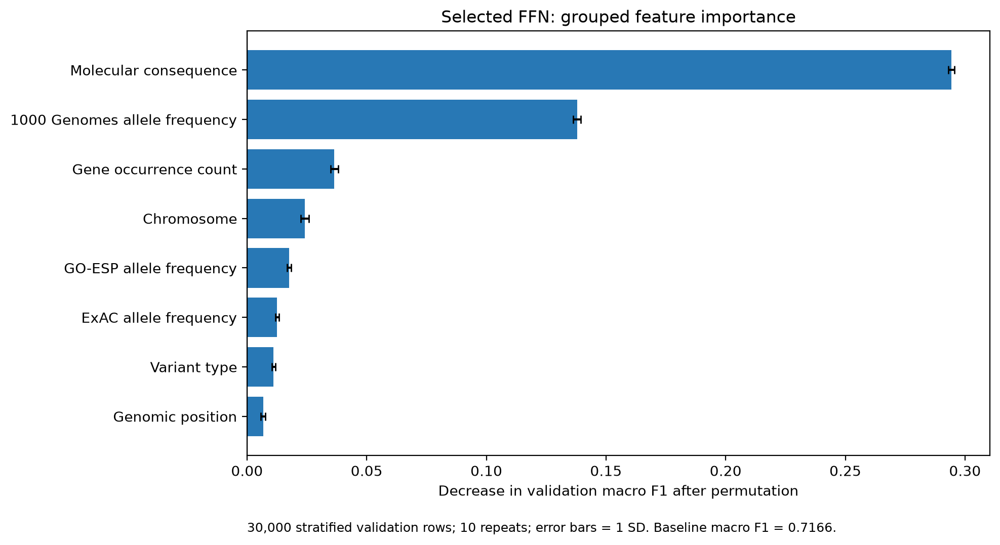
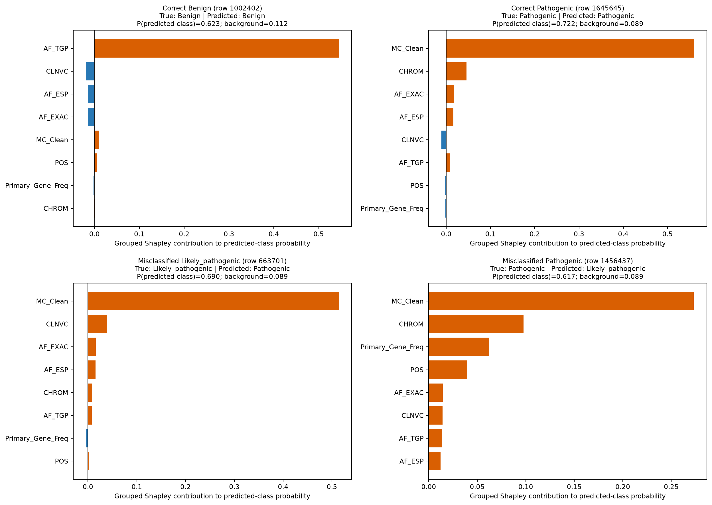

# FFN Tuning and Interpretability Analysis

Independent four-class FFN contribution by terrygao03-cell. All additions live in this directory; existing group notebooks, root documentation, datasets, and figures are preserved.

## Contents

- [Executed notebook](ffn_baseline.ipynb): original FFN reproduction, three controlled changes, and explanations.
- [Experiment overview](baseline_results/experiment_overview.csv): comparable validation scores.
- [Explanation report](baseline_results/ffn_explanations/ffn_explanation_summary.md): feature meanings, importance, local cases, and limits.
- `baseline_results/`: compact metrics, histories, model checkpoints, scaler, and figures.

## Controlled validation results

All rows below use the same 944,604 fitting rows, 236,151 validation rows, seed 42, batch order, and 20 epochs.

| Input processing | Hidden units | Dropout | Validation accuracy | Validation macro F1 |
|---|---:|---:|---:|---:|
| Unscaled control | 64 | 0.3 | 0.678761 | 0.202161 |
| Standardized numeric features | 64 | 0.3 | 0.853382 | 0.712790 |
| Standardized numeric features | 128 | 0.3 | 0.854373 | 0.718025 |
| Standardized numeric features | 128 | 0.2 | 0.855135 | 0.718276 |

Standardization produced the largest observed improvement. Increasing hidden width produced a smaller gain; reducing Dropout was nearly neutral. The validation-best tested configuration has 128 hidden units, Dropout 0.2, Adam learning rate 0.001, batch size 32, and 20 epochs. Its advantage over Dropout 0.3 is only 0.000251 macro F1 for one seed.

The original reproduced baseline used the full 70% training pool, so it is a separate reference rather than a row in the controlled validation table. Experiment 1 also records test results for the unscaled and standardized 64-unit models. Those test scores are not test scores for the final selected 128-unit model. No additional test evaluation was used for Experiments 2, 3, or model selection.

## Interpretation

Grouped permutation importance uses 30,000 stratified validation rows and ten repeats. It preserves each one-hot feature group. Molecular consequence, 1000 Genomes allele frequency, and the dataset gene-occurrence count produce the largest mean macro-F1 decreases when shuffled.

Four illustrative cases cover two correct predictions and two errors. The notebook directly computes exact grouped interventional Shapley values over eight groups and 256 coalitions using 64 training-background rows. It explains softmax probabilities for all four classes and checks local additivity. No SHAP package is required. See [case analysis](baseline_results/ffn_explanations/local_case_analysis.md).

## Reproduce

1. Use Python 3.14 (recorded environment: Windows, Python 3.14.3, CPU). Create your own environment and install this directory's `requirements.txt`.
2. Supply the group's `clinvar.csv` locally at the repository root, or set the `CLINVAR_CSV` environment variable to its path before starting the notebook kernel. The supplied data contain 1,686,794 records. The other CSV already in the repository is not a substitute for this workflow.
3. Open `ffn_baseline.ipynb`, select the environment, and run from either the repository root or this contribution directory. Paths write only under this contribution's `baseline_results/`.
4. A full Run All repeats the baseline and all experiments and takes time. To rerun explanations without retraining: execute sections 1-7, the code in sections 9-10 (imports, tensors, and FFN definition), sections 13-14 (fixed split and scaler), then sections 31-36. The final selected checkpoint is included. Missing validation-prediction files are regenerated during explanation loading.

The raw CSV, 187 MB cleaned CSV, large row-prediction CSVs, generated split-index arrays, and local environment are omitted. A full run regenerates these. Existing executed outputs and compact artifacts are supplied for review without rerunning training. Portability edits only replace local paths and allow regeneration of omitted predictions; they do not change the recorded experiment scores.

## Evaluation limits

- The reproduced workflow fitted categorical and gene-frequency encodings on all rows. Only the numeric scaler was fitted on fitting rows. This is an inherited evaluation limitation; the current results are not a fully leakage-free benchmark.
- The group's newer additional-model workflow in the root results document uses training-fitted encodings and separate calibration/validation partitions. These FFN validation numbers must not be treated as a directly matched comparison to those model test scores.
- One seed and one split do not establish stable superiority for small changes.
- Permutation importance and local Shapley values describe this fitted model, not biological causality. Correlated inputs and interventional background choices affect explanations. Gene occurrence count is not biological gene importance. Missing allele frequencies were filled with zero.

## References

- [Original group notebook](https://github.com/LakshyaMalik/Pathegenicity_Classification/blob/b6e0befd6bc43390af6c5a048108e816dd223bd8/data7703.ipynb)
- [Permutation importance](https://scikit-learn.org/stable/modules/permutation_importance.html)
- [Exact SHAP enumeration and background masking](https://shap.readthedocs.io/en/latest/generated/shap.ExactExplainer.html)
- [ClinVar field definitions](https://academic.oup.com/nar/article/46/D1/D1062/4641904)
