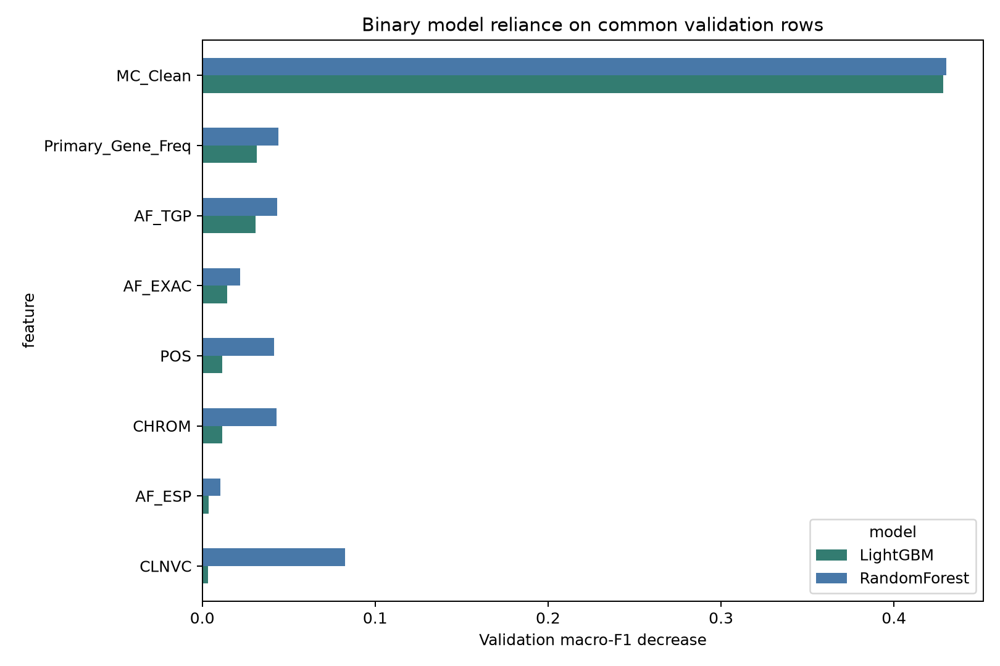

# Tree-model interpretability analysis

This contribution explains **four-class XGBoost**, **binary LightGBM**, and **binary Random Forest** from the group's `hao_models.ipynb` experiment. It adds an independent analysis folder; existing group files and the earlier FFN contribution are preserved.

## Start here

- [English interpretation, feature meanings, case analysis and limitations](tree_interpretability_results/interpretability_summary.md)
- [Executed analysis notebook](tree_model_interpretability.ipynb)
- [Verification record](tree_interpretability_results/verification_report.json)

## Main findings

Molecular consequence (`MC_Clean`) was the dominant feature group for all three selected models. Four-class XGBoost also relied on `AF_TGP`. On common binary validation samples, Random Forest relied more on variant type (`CLNVC`) than LightGBM: permutation macro-F1 decreases were 0.0827 and 0.0034, respectively.

These are absolute score decreases on a 6,000-record validation sample, not percentages or full-test performance estimates. Binary and four-class score-drop magnitudes are not directly comparable. Feature reliance does not establish biological causation.

## Figures

| Model/task | Global feature importance | Local correct/error cases |
|---|---|---|
| XGBoost, four-class | [Figure](tree_interpretability_results/XGBoost_four_class_global_importance.png) | [Figure](tree_interpretability_results/XGBoost_four_class_local_cases.png) |
| LightGBM, binary | [Figure](tree_interpretability_results/LightGBM_binary_global_importance.png) | [Figure](tree_interpretability_results/LightGBM_binary_local_cases.png) |
| Random Forest, binary | [Figure](tree_interpretability_results/RandomForest_binary_global_importance.png) | [Figure](tree_interpretability_results/RandomForest_binary_local_cases.png) |

## Methods and provenance

Grouped permutation importance uses eight original feature groups, 6,000 stratified validation records and five permutations. One-hot columns stay together. Error bars show permutation SD, not uncertainty over retraining.

Local grouped empirical interventional Shapley explanations enumerate all 256 coalitions with 64 fitting-background records. The explained outputs are complete sigmoid-calibrated class probabilities. Four model-specific cases cover correct benign/pathogenic predictions, false negatives and false positives. These are exact values for the specified masking game, not Tree SHAP. Model-specific error examples need not be the same variants.

Binary LightGBM reuses the retained original calibrated model. XGBoost and Random Forest were independently refitted because their fitted objects were absent from the original cache. Each model agreed with the first 2,000 cached validation probabilities within 2.98e-8. All 12 model-case explanations passed additivity checks (largest residual below 1.45e-15).

## Reproduction

1. Create/select a Python environment and install `requirements.txt`. The actual analysis used Python 3.14.3; Python 3.12.14 was used by the group cache producer.
2. Obtain the group's `data/prepared.joblib` and `data/experiment.joblib` from the teammate who ran `hao_models.ipynb`. These inputs are not included here. `prepared(1).joblib` is accepted as an alternate filename.
3. Open the notebook from the repository root, the personal contribution folder, or this analysis folder. If the cache directory is elsewhere, set `GROUP_MODEL_PROJECT` to its project root, or edit `PROJECT_DIR` in the configuration cell.
4. Set `ALLOW_REFIT_MISSING=True` only when the fitted XGBoost/RandomForest objects are missing and you want to reproduce those fits. The default stops before refitting. The selected LightGBM model must be present in the input state.
5. Run cells in order. New output and isolated models stay in this contribution's `tree_interpretability_results` directory; the original caches are read only.

The two setup cells in the portable notebook were edited after execution and have no saved output. The numerical analysis outputs and embedded plots were retained unchanged. Raw data, model binaries, virtual environments and local kernel registrations are excluded from this contribution.
